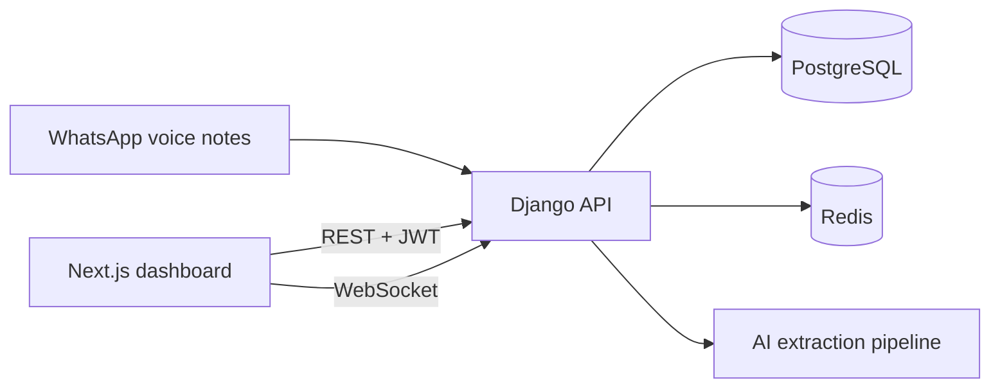

# Talk2Record

Talk2Record turns WhatsApp voice notes from business staff into structured business records using AI. Teams connect WhatsApp, capture voice updates in the field, and get searchable records, analytics, billing, and org workflows in a single SaaS dashboard.

This repository is a **monorepo**:

| Path                     | Role                                                            |
| ------------------------ | --------------------------------------------------------------- |
| [`frontend/`](frontend/) | Next.js 16 marketing site and authenticated dashboard           |
| [`backend/`](backend/)   | Django + DRF API, Celery workers, Channels WebSockets           |
| [`deploy/`](deploy/)     | VPS deployment runbook (Traefik, GitHub Actions, env templates) |
| [`docs/`](docs/)         | Architecture, auth, and integration notes                       |

Production: [talk2record.com](https://talk2record.com) · Staging: [staging.talk2record.com](https://staging.talk2record.com)

## How it works



1. Staff send voice notes via WhatsApp (or record in the browser).
2. The backend ingests audio, runs transcription and structured extraction (Celery).
3. The dashboard shows records, pipeline status, artifacts, analytics, and live notifications.
4. Organizations manage members, billing (Paddle), integrations, and usage limits.

See [`docs/system-architecture.md`](docs/system-architecture.md) for the full system design.

## Prerequisites

- **Docker** — local backend stack (Postgres, Redis, Mailpit, Celery)
- **Node.js 20+** — frontend (`npm`)
- **uv** (optional) — run Django commands on the host without Docker

## Local development

Run the **backend** and **frontend** in separate terminals.

### Backend (port 8000)

```bash
cd backend
make up          # start Postgres, Redis, Mailpit, Django, Celery
make migrate     # first run
make seed        # platform reference data (plans, legal docs, etc.)
```

- API: [http://localhost:8000/api/](http://localhost:8000/api/)
- OpenAPI: [http://localhost:8000/api/docs/](http://localhost:8000/api/docs/)
- Mailpit (dev email): [http://127.0.0.1:8025](http://127.0.0.1:8025)
- Flower (Celery): [http://localhost:5555](http://localhost:5555)

Local env files live under `backend/.envs/.local/` (committed templates). For Paddle checkout and webhooks in dev, see [Paddle billing (local dev)](backend/README.md#paddle-billing-local-dev) in the backend README.

Useful commands: `make help`, `make logs`, `make bash`, `make manage ARGS='...'`, `make uv-lock-ci`.

If CI fails on `Backend uv.lock (production uv)`, regenerate lock deterministically (same image/version CI uses):

```bash
cd backend
make uv-lock-ci
```

### Frontend (port 3000)

```bash
cd frontend
npm install
cp .env.example .env.local   # set NEXT_PUBLIC_API_BASE_URL if needed
npm run dev
```

Open [http://localhost:3000](http://localhost:3000). The API client defaults to `http://localhost:8000`.

### Full stack smoke test

1. Backend up and migrated; create a user via register or `make createsuperuser`.
2. Frontend running; sign in and complete onboarding if prompted.
3. Confirm `/api/schema/` returns JSON and the dashboard loads records/billing surfaces.

## Repository layout

```text
talk2record/
├── backend/           # Django project (talk2record.* apps, compose, Makefile)
├── frontend/          # Next.js App Router app
├── deploy/            # Traefik, bootstrap/deploy scripts, env examples
├── docs/              # AUTH.md, system architecture, prompts
├── .github/workflows/ # CI, image build, staging/production deploy
└── LICENSE            # Apache License 2.0
```

## CI and deployment

| Branch    | CI           | Deploy target                                   |
| --------- | ------------ | ----------------------------------------------- |
| `develop` | lint + tests | staging (`staging.talk2record.com`)             |
| `main`    | lint + tests | production (`talk2record.com`, manual approval) |

Workflows: [`.github/workflows/ci.yml`](.github/workflows/ci.yml), build images, deploy staging/production.

Operators: follow [`deploy/README.md`](deploy/README.md) for VPS bootstrap, secrets, Traefik, and rollback.

### Deployment secrets sync (GitHub Environments)

Push local deploy env files to GitHub Environment secrets:

```bash
cd backend
make sync-gha-env-staging
# or
make sync-gha-env-production
```

Equivalent generic form:

```bash
cd backend
make sync-gha-env GHA_ENV=staging
make sync-gha-env GHA_ENV=production
```

## Documentation

| Topic                               | Location                                                     |
| ----------------------------------- | ------------------------------------------------------------ |
| Frontend features, routes, env      | [`frontend/README.md`](frontend/README.md)                   |
| Django commands, Celery, Paddle dev | [`backend/README.md`](backend/README.md)                     |
| JWT vs Google OAuth                 | [`docs/AUTH.md`](docs/AUTH.md)                               |
| System architecture                 | [`docs/system-architecture.md`](docs/system-architecture.md) |
| Production/staging ops              | [`deploy/README.md`](deploy/README.md)                       |

## License

[Apache License 2.0](LICENSE)
