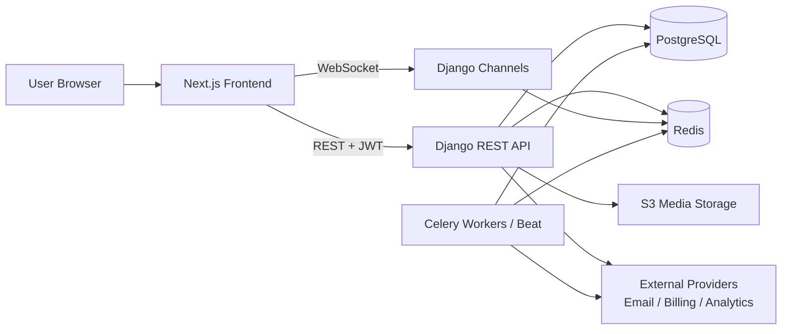
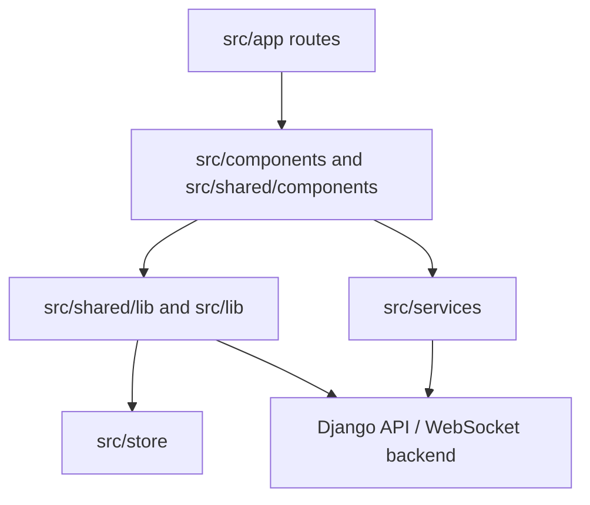
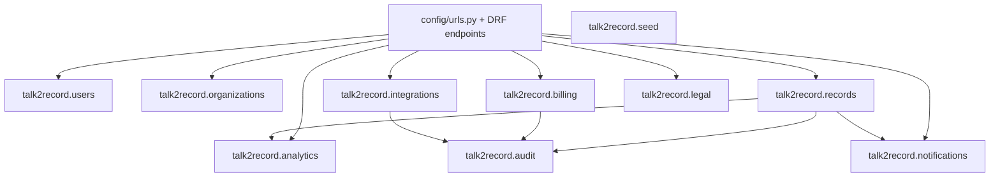
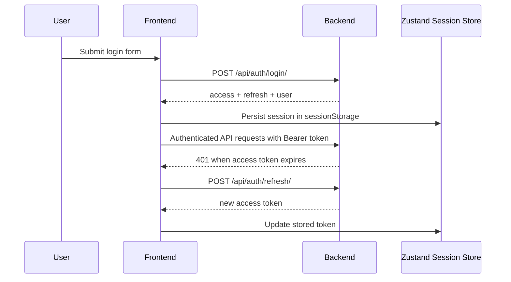
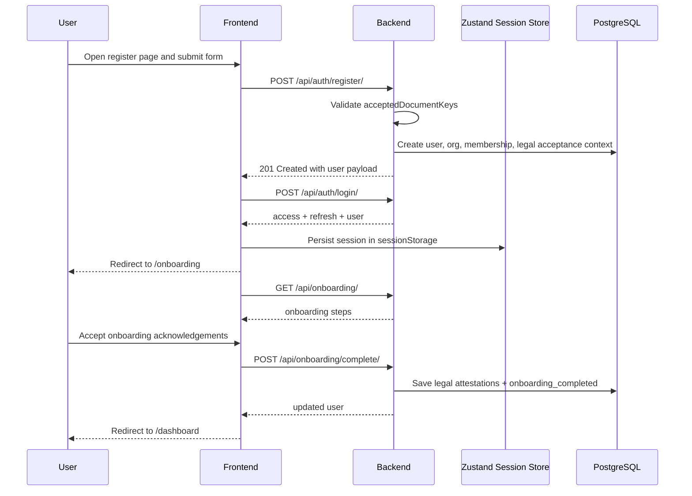
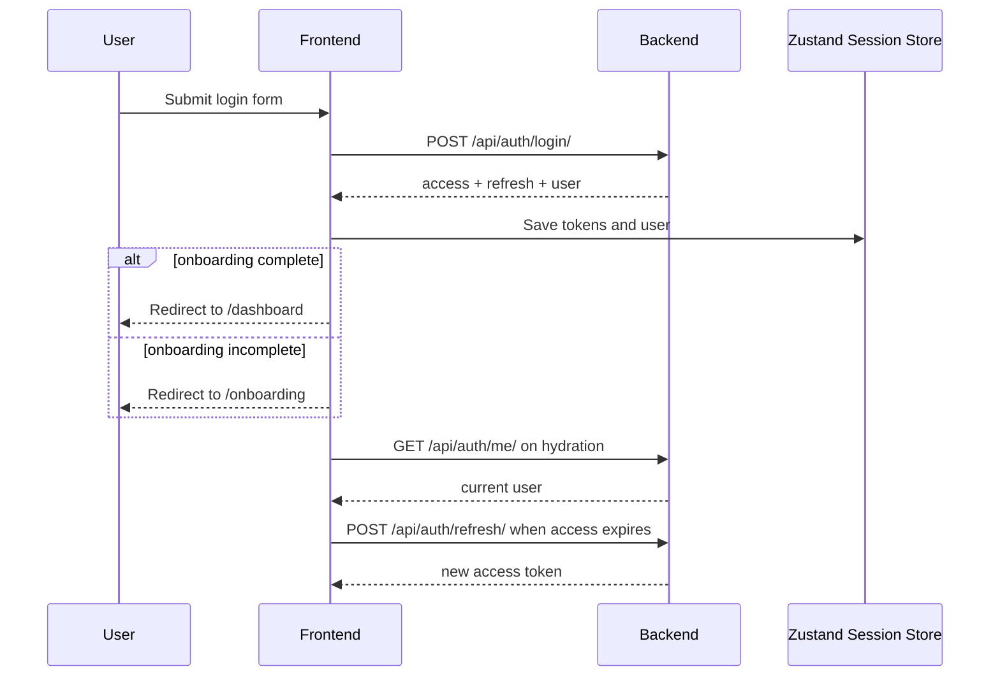
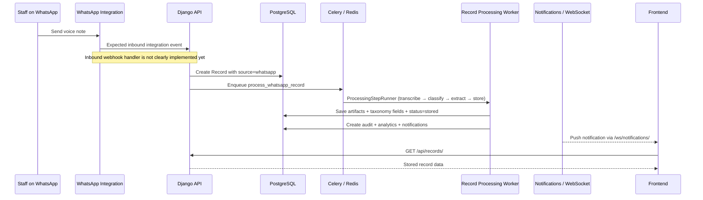
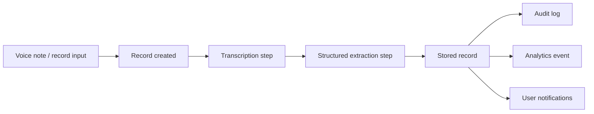

# Talk2Record System Architecture

This document describes the current application architecture for Talk2Record across the frontend and backend codebases.

## 1. High-Level Overview

Talk2Record is split into two main applications:

- `frontend/`: a Next.js App Router application that serves the marketing site, authentication flows, and the authenticated dashboard.
- `backend/`: a Django + Django REST Framework application that exposes REST APIs, JWT authentication, background processing, analytics, notifications, and billing/integration management.

The system currently follows a web SaaS pattern:

1. Users interact with the Next.js frontend.
2. The frontend calls the Django API over HTTP using JWT bearer tokens.
3. The backend persists core business data in PostgreSQL.
4. Redis supports Channels and Celery.
5. Background jobs process records and publish notifications.
6. The frontend subscribes to live notifications through WebSockets.

## 2. Frontend Architecture

### 2.1 Frontend Stack

The frontend is built with:

- Next.js 16
- React 19
- TypeScript
- Tailwind CSS 4
- React Query
- Zustand
- Axios
- Radix UI based components
- PostHog and Vercel Analytics

### 2.2 Frontend Responsibilities

The frontend is responsible for:

- marketing pages such as landing, pricing, features, and docs
- authentication pages and onboarding flows
- dashboard views for records, analytics, integrations, billing, and settings
- client-side session persistence
- API calls to the Django backend
- WebSocket subscriptions for live notifications
- UI state, theming, and localization support

### 2.3 Frontend Logical Layers

### 2.4 Frontend Structure

- `src/app`
  App Router entry points for marketing, auth, dashboard, and a small internal API surface.
- `src/components`
  Feature-oriented UI components.
- `src/shared/components`
  Shared UI building blocks, providers, and layout primitives.
- `src/lib`
  Infrastructure utilities such as the Axios API client, analytics, query client, and WebSocket helper.
- `src/services`
  Thin service wrappers around backend endpoints.
- `src/store`
  Zustand state, especially user session state.
- `src/shared/lib`
  Auth, i18n, and other cross-cutting frontend behavior.

### 2.5 Frontend Runtime Flow

- `AppProviders` composes theme, React Query, i18n, auth, and toast providers.
- Axios is configured in `src/lib/api.ts` to target `NEXT_PUBLIC_API_BASE_URL`.
- Access tokens are injected into requests from the Zustand auth store.
- On `401`, the client attempts a token refresh using the stored refresh token.
- Notification updates are received through a WebSocket connection to `/ws/notifications/`.

## 3. Backend Architecture

### 3.1 Backend Stack

The backend is built with:

- Django 6
- Django REST Framework
- SimpleJWT
- Django Allauth
- Django Channels
- Celery + django-celery-beat
- PostgreSQL
- Redis
- django-storages with S3 support
- drf-spectacular

### 3.2 Backend Responsibilities

The backend is responsible for:

- JWT-based authentication and account management
- organization and membership management
- record storage and record processing orchestration
- analytics and dashboard summaries
- notifications and WebSocket fan-out
- billing, subscriptions, and webhook ingestion
- legal document tracking and acceptance records
- audit logging
- integration configuration and encrypted credentials

### 3.3 Backend Module Map

### 3.4 Backend Layers

- `config/`
  Project settings, URL routing, ASGI setup, Celery bootstrap, and Channels routing.
- `talk2record.users`
  Registration, login, logout, current user, onboarding, and settings profile endpoints.
- `talk2record.organizations`
  Multi-tenant organization and membership domain.
- `talk2record.records`
  Core structured business record model, views, services, and tasks.
- `talk2record.analytics`
  Snapshot endpoints, metrics, and event tracking.
- `talk2record.billing`
  Subscription management, checkout actions, invoices, and billing webhooks.
- `talk2record.integrations`
  Organization integrations and encrypted configuration storage.
- `talk2record.notifications`
  Persistent notifications and WebSocket consumer.
- `talk2record.legal`
  Legal document versions, profiles, and acceptance metadata.
- `talk2record.audit`
  Audit logging for sensitive or important actions.

### 3.5 API Surface

The backend exposes:

- REST endpoints under `/api/`
- auth endpoints such as `/api/auth/login/`, `/api/auth/refresh/`, `/api/auth/logout/`, and `/api/auth/me/`
- dashboard and analytics endpoints such as `/api/dashboard/` and `/api/analytics/`
- router-driven resources including records, organizations, memberships, notifications, billing, integrations, legal documents, and daily metrics
- WebSocket notifications under `/ws/notifications/`
- OpenAPI schema and Swagger docs under `/api/schema/` and `/api/docs/`

## 4. Authentication and Session Model

The main application auth flow is backend-driven JWT authentication.

Notes:

- The frontend persists auth state in `sessionStorage` using Zustand middleware.
- Backend APIs use JWT authentication by default.
- Django Allauth is also configured, mainly for account workflows and admin-related account flows.
- `next-auth` exists in the frontend, but the primary product auth path currently appears to be the backend JWT flow.

## 5. Current User Flows

This section describes the current end-to-end user journey based on the code that exists today.

### 5.1 New Account Creation and First-Time Setup

The current signup flow is:

1. The user opens the frontend registration page.
2. The user enters name, company, email, password, and accepts required legal documents.
3. The frontend sends `POST /api/auth/register/`.
4. The backend validates required accepted legal document keys.
5. The backend registration service creates the user and organization context.
6. The frontend immediately logs the user in by calling `POST /api/auth/login/`.
7. JWT tokens and the serialized user are stored in the frontend session store.
8. The frontend redirects the user to `/onboarding`.
9. The onboarding page fetches progress from `GET /api/onboarding/`.
10. The user reviews the legal acknowledgements and completes onboarding through `POST /api/onboarding/complete/`.
11. The backend records onboarding attestations and marks `onboarding_completed = true`.
12. The frontend redirects the user to `/dashboard`.

What the onboarding page currently checks:

- WhatsApp integration connected
- at least one record exists
- company setup acknowledgements are completed

### 5.2 Returning User Login Flow

The current login and session-resume flow is:

1. The user opens `/login`.
2. The frontend sends `POST /api/auth/login/` with email and password.
3. The backend returns `access`, `refresh`, and `user`.
4. The frontend stores the session in Zustand backed by `sessionStorage`.
5. The user is redirected:
   if onboarding is incomplete, to `/onboarding`
   otherwise, to `/dashboard`
6. On app reload, the frontend checks whether a refresh token exists locally.
7. If a session exists, the frontend calls `GET /api/auth/me/` to re-sync the current user.
8. If an access token expires during API usage, the frontend calls `POST /api/auth/refresh/`.
9. If refresh fails, the frontend clears the local session and returns the user to an unauthenticated state.

### 5.3 WhatsApp Message to Record Flow

The intended product flow is that business staff send a WhatsApp voice note and Talk2Record turns it into a structured record.

The current repository shows this flow only partially:

- there is a WhatsApp integration state in onboarding and integrations
- records support `source = whatsapp`
- there is a background processing pipeline for transcription, extraction, and storage
- there is not yet a clearly implemented inbound WhatsApp webhook endpoint in the code inspected here

So the current architecture should be understood as:

1. An organization connects WhatsApp through the integrations flow.
2. The integration can be marked connected through the integrations action endpoint.
3. A record is expected to enter the system with source metadata such as `source = whatsapp`, `source_reference`, and optional `audio_url`.
4. Background tasks process the record through transcription, structured extraction, and final storage.
5. On success, the backend logs the event, updates analytics, and creates notifications for active organization members.
6. The frontend can then show the record in the dashboard and receive notification updates over WebSockets.

Current practical nuance:

- The integrations module can mark WhatsApp as connected and record a legal attestation for voice-data processing permissions.
- The `RecordProcessingService` currently uses placeholder/mock logic for transcription and extraction rather than a real WhatsApp or speech-to-text provider.

## 6. Record Processing Flow

The product concept is voice-note-to-record processing, but the current backend implementation is partly scaffolded.

Current code behavior:

- transcription is currently placeholder logic rather than a real speech-to-text provider
- structured extraction is currently mock-like default enrichment
- when a record reaches stored state, the backend logs an audit event, tracks analytics, and creates notifications for active organization members

## 7. Data and Infrastructure Architecture

### 6.1 Core Data Stores

- PostgreSQL stores users, organizations, memberships, records, subscriptions, integrations, notifications, legal data, and audit data.
- Redis acts as:
  a Celery broker and result backend
  a Channels layer backend for WebSockets

### 6.2 Async and Real-Time Components

- Celery workers execute background jobs.
- Celery Beat schedules recurring tasks.
- Django Channels provides real-time notification delivery.
- Redis connects the API, Channels layer, and background workers.

### 6.3 Storage and External Services

- media files can be stored using S3-backed storage in production
- email delivery is configured through Brevo in production
- Sentry is configured for error monitoring
- billing provider integrations exist behind an abstraction layer, though some current provider behavior is still mock-backed

## 8. Deployment View

The backend has clear containerized deployment support:

- Docker Compose for local and production environments
- dedicated services for Django, PostgreSQL, Redis, Celery worker, Celery Beat, and Flower
- Traefik-based production routing
- WhiteNoise for static assets

The frontend appears designed for standard Next.js hosting and includes Vercel Analytics, which suggests Vercel-friendly deployment, though a dedicated frontend deployment manifest is not present in the repository root.

## 9. Architecture Notes and Current Gaps

This reflects the current implementation in the repository, not just the intended product vision.

- The frontend and backend are cleanly separated and communicate over REST and WebSockets.
- The backend is multi-tenant in shape through organizations and memberships.
- Record processing infrastructure exists, but actual AI or speech-processing providers are not yet fully wired in.
- Billing and third-party integrations have the right structural boundaries, but some providers are still placeholders or mocks.
- There are signs of both JWT auth and `next-auth`, but JWT is the dominant product path today.
- The repo models the WhatsApp journey, but the inbound webhook or ingestion handler still appears incomplete or absent.

## 10. Recommended Mental Model

Use this model when reasoning about the system:

1. `frontend/` owns user experience, client session state, and UI composition.
2. `backend/` owns business rules, persistence, auth, integrations, async jobs, and real-time events.
3. PostgreSQL is the source of truth.
4. Redis enables background and live features.
5. Celery and Channels provide the non-request/response processing layer.
